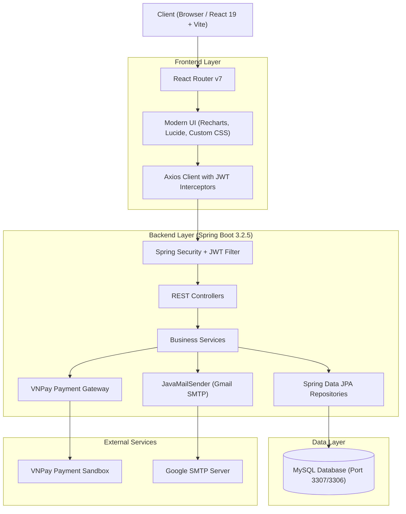

# 📚 UTCBook - Library Management System

<p align="center">
  
  
  
  
  
  
</p>

---

## 📖 Giới thiệu tổng quan (Overview)

**UTCBook** là nền tảng quản lý thư viện hiện đại, toàn diện kết hợp giữa ứng dụng Web SPA (Single Page Application) tương tác cao và cổng thanh toán trực tuyến **VNPay Sandbox**. Hệ thống được thiết kế hướng tới việc số hóa toàn bộ quy trình mượn - trả sách, nâng cao trải nghiệm khám phá tri thức của độc giả và tự động hóa công tác quản trị, thống kê số liệu của thủ thư / ban quản trị.

---

## ✨ Tính năng nổi bật (Key Features)

### 👤 1. Phân hệ Độc giả (User / Member Portal)
- **Khám phá sách (Netflix-style Discovery)**:
  - Trình duyệt sách đa chiều với các hàng carousel mượt mà: *Sách nổi bật (Trending)*, *Đánh giá cao nhất (Top Rated)*, *Sách mới phát hành (New Arrivals)*, và *Được đọc nhiều nhất (Most Read)*.
  - Bộ lọc tìm kiếm thông minh theo thể loại (Genre), từ khóa, tác giả và trạng thái sẵn sàng.
- **Chi tiết sách & Đánh giá (Book Details & Reviews)**:
  - Xem thông tin chi tiết, số lượng bản sao còn lại, tóm tắt nội dung.
  - Đánh giá sao và viết bình luận (chống trùng lặp đánh giá từ cùng một độc giả).
  - Thêm / bớt sách vào Danh sách yêu thích (Wishlist).
- **Quy trình Mượn & Đặt trước (Loan & Reservation Workflow)**:
  - **Mượn sách**: Quản lý lịch sử mượn trả theo thời gian thực (hỗ trợ độ chính xác tới từng phút `LocalDateTime`).
  - **Đặt sách online**: Luồng máy trạng thái 4 bước (`PENDING` ➔ `READY` ➔ `USER_CONFIRMED` ➔ `BORROWED`), hỗ trợ hủy hoặc từ chối lịch đặt khi hết sách.
  - Gia hạn sách trực tuyến khi sắp tới hạn trả.
- **Quản lý Tiền phạt & Nộp phạt trực tuyến (Fines & VNPay)**:
  - Tra cứu các khoản phạt quá hạn phát sinh.
  - Thanh toán tiền phạt trực tuyến tức thì qua cổng thanh toán VNPay Sandbox.
- **Gói Hội viên VIP (Subscription Plans)**:
  - Đăng ký và gia hạn các gói thành viên đặc quyền (theo tháng / năm) thông qua VNPay.
- **Bảo mật & Tài khoản**:
  - Đăng ký, đăng nhập với mã hóa JWT bảo mật.
  - Quên mật khẩu & Đổi mật khẩu an toàn với xác thực mã OTP qua Gmail SMTP.

---

### 🛡️ 2. Phân hệ Quản trị & Thủ thư (Admin Dashboard & Management)
- **Bảng điều khiển trực quan (Analytics & Dashboard)**:
  - Thống kê tổng doanh thu thực tế, doanh thu từ gói hội viên, tổng tiền phạt phát sinh.
  - Tỷ lệ sách sẵn sàng mượn và số lượng sách đang lưu hành.
  - Biểu đồ xu hướng doanh thu Recharts linh hoạt với **bộ lọc theo Ngày (Day), Tuần (Week), và Tháng (Month)**.
- **Quản lý Danh mục & Sách (Catalog & Books)**:
  - CRUD thông tin sách, ảnh bìa, số lượng ấn bản (Total Copies vs Available Copies).
  - Thêm sách hàng loạt (Bulk Import).
  - Quản lý thể loại (Genres).
- **Quản lý Mượn - Trả sách (Loans Management)**:
  - Giao diện dạng thẻ (Card Grid) hiện đại, tra cứu nhanh tình trạng mượn quá hạn, đã trả, hoặc đang mượn.
  - Thao tác trả sách và tính tiền phạt trễ hạn tự động.
- **Quản lý Đặt trước sách (Reservations Kanban)**:
  - Quản lý quy trình duyệt đơn đặt trước sách của độc giả.
- **Quản lý Tiền phạt (Fines Management)**:
  - Danh sách phạt, theo dõi trạng thái phạt (`PENDING`, `PAID`, `WAIVED`).
  - Hỗ trợ thủ thư miễn giảm tiền phạt (`WAIVE`) cho các trường hợp đặc biệt.
- **Sổ cái Giao dịch (Payment Ledger)**:
  - Bộ lọc nâng cao: Lọc theo cổng thanh toán, loại giao dịch, trạng thái, khoảng ngày và tên độc giả.
- **Quản lý Người dùng & Phân quyền (User Management)**:
  - Quản lý tài khoản độc giả, kích hoạt / khóa tài khoản, phân quyền Role (`ADMIN`, `LIBRARIAN`, `USER`).

---

## 🏗️ Kiến trúc hệ thống (System Architecture)



---

## 💻 Công nghệ sử dụng (Tech Stack)

### **Backend**
| Công nghệ | Phiên bản | Mục đích |
| :--- | :--- | :--- |
| **Java** | 17 (LTS) | Ngôn ngữ lập trình chính |
| **Spring Boot** | 3.2.5 | Framework nền tảng xây dựng RESTful API |
| **Spring Data JPA / Hibernate** | 3.2.5 | Tương tác cơ sở dữ liệu ORM |
| **Spring Security & JJWT** | 0.11.5 | Xác thực & phân quyền người dùng qua JWT |
| **MySQL Connector** | 8.0+ | Driver kết nối MySQL Server |
| **JavaMailSender** | - | Gửi email thông báo & mã xác thực OTP |
| **MapStruct & Lombok** | 1.5.5 / 1.18.34 | Giảm thiểu boilerplate code & ánh xạ DTO |
| **SpringDoc OpenAPI** | 2.5.0 | Tài liệu hóa API tự động (Swagger UI) |

### **Frontend**
| Công nghệ | Phiên bản | Mục đích |
| :--- | :--- | :--- |
| **React** | 19.2.4 | Thư viện xây dựng giao diện người dùng |
| **Vite** | 8.0.4 | Toolchain xây dựng và biên dịch frontend siêu tốc |
| **React Router** | 7.14.0 | Quản lý định tuyến và điều hướng SPA |
| **Recharts** | 3.8.1 | Biểu đồ trực quan hóa dữ liệu doanh thu |
| **Axios** | 1.15.0 | Gửi HTTP requests kết nối Backend API |
| **React Icons & Lucide React** | - | Bộ icon phong phú, hiện đại |
| **React Hot Toast** | 2.6.0 | Hiển thị thông báo toast notification tương tác |

---

## 📂 Cấu trúc thư mục (Project Structure)

```text
Library Management/
├── backend/                                # Mã nguồn Spring Boot Backend
│   ├── src/
│   │   ├── main/
│   │   │   ├── java/com/slayer/backend/
│   │   │   │   ├── config/                 # Cấu hình Security, JWT, CORS, VNPay
│   │   │   │   ├── controller/             # Các REST API Controller
│   │   │   │   ├── dto/                    # Data Transfer Objects
│   │   │   │   ├── entity/                 # JPA Entities (Book, BookLoan, Payment, User,...)
│   │   │   │   ├── Enums/                  # Enum trạng thái (LoanStatus, FineStatus, Role,...)
│   │   │   │   ├── payload/                # Request & Response model payloads
│   │   │   │   ├── repository/             # Spring Data JPA Repositories
│   │   │   │   └── service/                # Business Logic Interfaces & Implementations
│   │   │   └── resources/
│   │   │       ├── application.properties  # File cấu hình database, email, api keys
│   │   │       └── static/ & templates/
│   │   └── test/                           # Unit tests & Integration tests
│   └── pom.xml                             # Cấu hình Maven dependencies
│
├── frontend/                               # Mã nguồn React Frontend
│   └── library-frontend/
│       ├── src/
│       │   ├── api/                        # Cấu hình Axios & các hàm gọi API theo module
│       │   ├── components/                 # Các UI component tái sử dụng (Modal, Navbar,...)
│       │   ├── context/                    # React Context (AuthContext, Theme,...)
│       │   ├── layouts/                    # Layout Admin và Layout User
│       │   ├── pages/                      # Các trang màn hình giao diện
│       │   │   ├── admin/                  # Dashboard, Quản lý sách, Đơn mượn, Tiền phạt
│       │   │   ├── auth/                   # Đăng nhập, Đăng ký, Quên mật khẩu
│       │   │   ├── error/                  # Trang lỗi 404 & Error Boundary
│       │   │   └── user/                   # Trang chủ, Chi tiết sách, Mượn sách, Gói VIP
│       │   └── routes/                     # Cấu hình Router & Protected Routes
│       ├── package.json                    # Cấu hình thư viện frontend
│       └── vite.config.js                  # Cấu hình Vite bundler
│
└── README.md                               # Tài liệu hướng dẫn dự án
```

---

## 🚀 Hướng dẫn cài đặt & Khởi chạy (Getting Started)

### 📋 Yêu cầu môi trường (Prerequisites)
- **Java Development Kit (JDK)**: Phiên bản 17 trở lên.
- **Node.js**: Phiên bản 18.x hoặc 20.x trở lên.
- **MySQL Server**: Phiên bản 8.0 trở lên.
- **Git** (khuyên dùng).

---

### 🗄️ Bước 1: Cấu hình Cơ sở dữ liệu (MySQL Database)
1. Mở MySQL Client (MySQL Workbench, DBeaver hoặc CLI) và tạo database:
   ```sql
   CREATE DATABASE LibraryManagement CHARACTER SET utf8mb4 COLLATE utf8mb4_unicode_ci;
   ```
2. Cập nhật cổng và thông tin đăng nhập trong file `backend/src/main/resources/application.properties` (mặc định cấu hình cổng `3307` hoặc đổi thành `3306` tùy máy bạn):
   ```properties
   spring.datasource.url=jdbc:mysql://localhost:3307/LibraryManagement?useSSL=false&serverTimezone=UTC
   spring.datasource.username=root
   spring.datasource.password=YourPasswordHere
   ```

---

### ⚙️ Bước 2: Cấu hình Backend (Spring Boot)
Mở file `backend/src/main/resources/application.properties` và thiết lập các biến sau:

```properties
# 1. Cấu hình Email (Dùng gửi OTP đặt lại mật khẩu)
spring.mail.username=your-email@gmail.com
spring.mail.password=your-app-password

# 2. Cấu hình VNPay Sandbox
vnpay.tmn-code=YOUR_VNPAY_TMN_CODE
vnpay.secret-key=YOUR_VNPAY_SECRET_KEY
vnpay.pay-url=https://sandbox.vnpayment.vn/paymentv2/vpcpay.html
vnpay.return-url=http://localhost:8080/api/payment/vnpay-return
```

**Khởi chạy Backend:**
```bash
cd backend

# Cách 1: Sử dụng Maven Wrapper
./mvnw clean spring-boot:run     # Trên Linux / macOS
mvnw.cmd clean spring-boot:run    # Trên Windows

# Cách 2: Nếu máy đã cài Maven sẵn
mvn clean spring-boot:run
```
> 🌐 Backend API sẽ khởi chạy tại: `http://localhost:8080`  
> 📑 Xem tài liệu Swagger UI tại: `http://localhost:8080/swagger-ui/index.html`

---

### 💻 Bước 3: Cấu hình & Khởi chạy Frontend (React + Vite)

1. Mở cửa sổ Terminal mới và chuyển vào thư mục frontend:
   ```bash
   cd frontend/library-frontend
   ```
2. Cài đặt các thư viện phụ thuộc:
   ```bash
   npm install
   ```
3. Khởi chạy môi trường phát triển:
   ```bash
   npm run dev
   ```
4. Truy cập giao diện ứng dụng trên trình duyệt tại:
   ```text
   http://localhost:5173
   ```

---

## 📌 Các cổng và đường dẫn mặc định (Default Endpoints)

| Dịch vụ | Địa chỉ URL | Ghi chú |
| :--- | :--- | :--- |
| **Frontend Web App** | `http://localhost:5173` | Giao diện cho người dùng & Admin |
| **Backend REST API** | `http://localhost:8080` | Endpoint dịch vụ backend |
| **Swagger UI** | `http://localhost:8080/swagger-ui/index.html` | Thử nghiệm & tra cứu toàn bộ REST API |
| **OpenAPI Docs (JSON)** | `http://localhost:8080/v3/api-docs` | OpenAPI Schema |

---

## 🛡️ Bản quyền & Đóng góp (License & Author)

- Dự án được phát triển nhằm mục đích học tập, nghiên cứu và quản lý thư viện thực tế.
- Mọi đóng góp, báo cáo lỗi (issues) hoặc yêu cầu tính năng mới (pull requests) đều được hoan nghênh!

---
<p align="center">Made with ❤️ for modern libraries and book lovers.</p>
